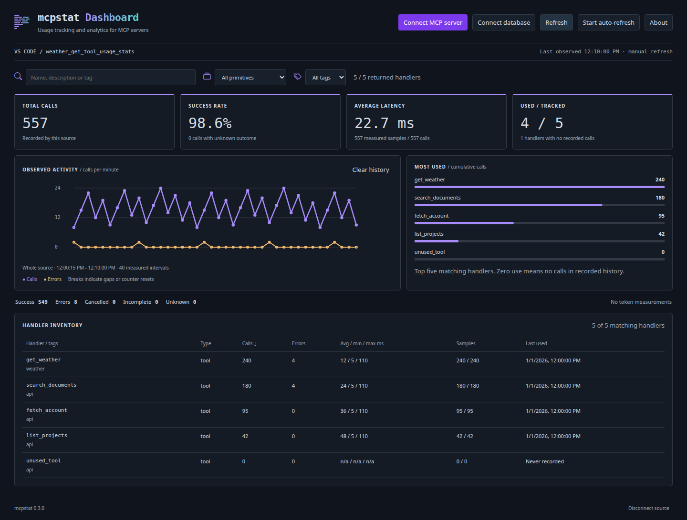

# mcpstat for Visual Studio Code

[](https://marketplace.visualstudio.com/items?itemName=vadikus.mcpstat-dashboard)
[](https://github.com/tekkidev/mcpstat-vscode/actions/workflows/verify.yaml)
[](https://github.com/tekkidev/mcpstat-vscode/actions/workflows/codeql.yaml)
[](LICENSE)

Monitor Model Context Protocol (MCP) tool, prompt and resource usage, errors and latency
directly in VS Code. See which handlers run, which fail, and which have no recorded calls.

Requires **VS Code 1.100+** and a server instrumented with
**[mcpstat 0.3.0](https://mcpstat.vadim.dev)**.
The dashboard reads that server's statistics tool or its local SQLite database.
It does not automatically track other MCP servers.

## Install

Open **Extensions** (**Ctrl+Shift+X** on Windows/Linux, **Cmd+Shift+X** on macOS),
search for `vadikus.mcpstat-dashboard`, and select **Install**.

Or install from the terminal:

```bash
code --install-extension vadikus.mcpstat-dashboard
```



## What you can see

- Calls and recorded outcomes for tools, prompts and resources.
- Measured latency, most-used handlers and registrations with no recorded calls.
- Reported token counts and estimates, when the server provides them.
- Changes observed during your session, with search, primitive and tag filters.

## Connect your MCP server

Open the Command Palette (**Ctrl+Shift+P** on Windows/Linux, **Cmd+Shift+P** on
macOS) and run **mcpstat: Get Started** for the setup walkthrough, or connect directly:

1. Start your instrumented MCP server in VS Code.
2. Run **mcpstat: Connect MCP Server** from the Command Palette.
3. Choose that server's `get_tool_usage_stats` tool, including its VS Code prefix.

The dashboard uses VS Code's existing tool connection and authentication. The
statistics tool can have a custom prefix, such as `fetch_tool_usage_stats`.
The connection picker updates as VS Code loads tools, so you can start the server
while the picker is open. **mcpstat: Check MCP Discovery** shows the available tool
counts and can copy a troubleshooting summary containing versions and counts.

The first statistics request may require approval in VS Code. Allow up to two minutes
to approve it and receive the result. Editor connections start with manual refresh;
use **Refresh** for another observation or **Start auto-refresh** for periodic updates.
When you enable editor auto-refresh, the dashboard shows how to open
**Chat: Manage Tool Approval** and pre-approve the selected statistics tool
(**without approval**). Choose **Start auto-refresh** to continue or **Keep manual
refresh** to cancel. The dashboard checks whether that command is available;
VS Code does not expose saved approval grants, so it cannot check your approval
status or change editor permissions.

VS Code controls tool approvals and may ask on every invocation, depending on editor
version and organization policy. See the [approval instructions](https://code.visualstudio.com/docs/agents/run/approvals#manage-tool-approvals).
A server can declare its statistics tool with `readOnlyHint: true` and
`openWorldHint: false` when those
[MCP annotations](https://modelcontextprotocol.io/specification/2025-11-25/schema#toolannotations)
accurately describe its behavior. Restart the server after changing its registration.
Automatic refresh pauses after a failed request; **Refresh** retries it.

Your server must expose its statistics through an MCP tool. The
[integration guide](https://github.com/tekkidev/mcpstat/blob/main/docs/quickstart.md)
shows how to register `get_tool_usage_stats` alongside your business tools.

If a server has no compatible statistics tool or returns an unsupported statistics
payload, a dashboard notice links to that guide. Install mcpstat in the server's
Python environment, configure tracking, register the statistics tool, and restart
the server. The dashboard cannot determine installed packages remotely.

### Missing Chat or MCP controls

If VS Code's built-in Chat or MCP controls are hidden, open Settings and search
`@id:chat.disableAIFeatures`. If **Chat: Disable AI Features** is checked, uncheck it
in the active profile or workspace, run **Developer: Reload Window**, then
**MCP: List Servers**. An organization policy may control the setting.

See [VS Code's AI settings reference](https://code.visualstudio.com/docs/agents/reference/ai-settings).
Direct HTTP and database connections do not need the built-in Chat controls.
If the controls are visible but no statistics tool appears, start your server and
confirm that it registers `get_tool_usage_stats`. Then run
**mcpstat: Check MCP Discovery**.

## Connect an HTTP endpoint

Choose **Connect an HTTP MCP endpoint** in the connection picker. Enter the server's
Streamable HTTP endpoint, for example `https://example.com/mcp`, then select its
authentication method and statistics tool. Direct connections support anonymous
access or a bearer token. Existing OAuth connections can be used through VS Code's
registered statistics tool.

Remote endpoints use HTTPS; local development endpoints can use HTTP on loopback.
Enter bearer tokens in the password prompt, separately from the endpoint URL.

## Open a statistics database

1. Install the extension, then open a trusted workspace.
2. Set **mcpstat: Python Path** to a Python 3.10+ executable. Its standard library is
   sufficient. On Windows,
   select your Python executable or use `python` if that is your installed command.
3. Run **mcpstat: Connect Statistics Database** from the Command Palette.
4. Select the existing SQLite database and choose a server if it contains several.

The reader opens database schema 4 in SQLite read-only mode, including committed WAL
data while the server runs, preserving its schema and statistics. SQLite may use its
normal shared-memory coordination files.

With Remote SSH, WSL or containers, the extension runs on the workspace extension
host. The database and Python executable must be accessible on that host.

## Saved connections

The selected MCP tool, HTTP endpoint or database is remembered for this workspace.
Open **mcpstat: Open Dashboard** after restarting VS Code to resume collection.
HTTP bearer tokens are stored in VS Code SecretStorage. **Disconnect Source** clears
the saved selection and its HTTP token; **Connect MCP Server** selects another source.

## Read the dashboard

- Cumulative calls, known-outcome success rate, latency and used/tracked handlers.
- Success, error, cancellation, incomplete and unknown outcome counts.
- Most-used handlers and a searchable table with primitive and tag filters.
- Reported token counts and estimates displayed separately, when present.
- Calls and errors per minute calculated from successive statistics observations.

The activity chart covers the whole selected source; filters affect the cumulative
cards, rankings and table. Automatic refresh defaults to 15 seconds while the panel
is visible. HTTP and database sources start automatically; editor tool connections
start manually. **Start auto-refresh** and **Pause auto-refresh** apply to this session.
At most 240 observations are retained in memory. Hiding or closing the panel pauses
collection; disconnect, reload and **Clear Dashboard History** discard the chart history.
The saved source remains available after a reload.

Missing observations, counter resets and changed inventories break chart lines.
Cumulative values cover the selected server's recorded activity across its clients.
Charts cover the intervals observed by this dashboard. Statistics queries may
themselves be tracked by the host server.

An unused handler means zero calls in the available recorded history. Synchronize
your server's registrations to include unused handlers in the catalog. Latency averages
use measured samples; historical outcome and latency coverage is shown explicitly.
A source exceeding 1000 handlers is labelled partial, and interval graphs are disabled.
The table shows up to 200 matches; search and filters narrow it.

## Privacy and security

Statistics are processed in the extension host. The connection profile is stored per
workspace, bearer tokens use VS Code SecretStorage, and chart history stays in memory.
Scripts, styles and charts are bundled with the extension. Documentation links open
when clicked. The extension does not add telemetry. README screenshots and badges
are hosted by GitHub and Shields.io; VS Code may fetch them when you open the
extension's Details page.

MCP polling invokes the selected statistics tool. Direct HTTP connections use the
official MCP client with origin-restricted requests and bounded responses. Optional
database access uses read-only SQLite through your configured Python interpreter.
Requests, execution, query time and history are bounded. Workspace Trust is required.

Statistics may include handler names, descriptions and tags. Give access only to
people who may inspect that server's activity, and authorize the statistics tool
in the server. The dashboard uses that connection's permissions. SQLite access is
read-only; MCP requests invoke the selected statistics tool under the server's
control. See the [security policy](SECURITY.md) for private vulnerability reports.

## Commands and settings

Open the Command Palette to run these commands:

| Command | Purpose |
| --- | --- |
| **mcpstat: Open Dashboard** | Open the dashboard and resume its saved connection. |
| **mcpstat: Get Started** | Follow the server setup and connection walkthrough. |
| **mcpstat: Open Server Integration Guide** | Open the Python server tracking guide. |
| **mcpstat: Connect MCP Server** | Select an editor statistics tool or an HTTP endpoint. |
| **mcpstat: Connect Statistics Database** | Open an existing statistics database read-only. |
| **mcpstat: Check MCP Discovery** | Inspect tool discovery and hidden AI controls. |
| **mcpstat: Refresh Dashboard** | Request another observation. |
| **mcpstat: Clear Dashboard History** | Discard the session's chart observations. |
| **mcpstat: Disconnect Source** | Clear the saved selection and its HTTP token. |

| Setting | Default | Purpose |
| --- | --- | --- |
| `mcpstat.refreshSeconds` | `15` | Automatic refresh interval, from 5 to 300 seconds while visible. |
| `mcpstat.pythonPath` | `python3` | Python 3.10+ executable on the extension host, used only for SQLite access. |
| `mcpstat.showSidebar` | `false` | Show the optional mcpstat Activity Bar view. |

Enable **mcpstat: Show Sidebar** for connection status, the last observed calls,
errors and handler counts, and connection actions. The sidebar does not collect
statistics in the background; automatic refresh still requires a visible dashboard.

## Feedback and support

[Report an issue or suggest an improvement](https://github.com/tekkidev/mcpstat-vscode/issues).
Include the extension and VS Code versions, connection type, and steps to reproduce.
**mcpstat: Check MCP Discovery** can copy a summary of versions and tool counts.
Remove tokens, private endpoints, database paths and private handler names from
anything you share.

## Integration and project links

- [Add mcpstat tracking to a Python MCP server](https://github.com/tekkidev/mcpstat/blob/main/docs/quickstart.md)
- [Documentation](https://mcpstat.vadim.dev)
- [Python API](https://github.com/tekkidev/mcpstat/blob/main/docs/api.md)
- [Agent documentation index](https://mcpstat.vadim.dev/llms.txt)
- [Extension agent index](llms.txt)
- [Full agent reference](https://mcpstat.vadim.dev/llms-full.txt)
- [PyPI package](https://pypi.org/project/mcpstat/)
- [MCP Registry listing](https://registry.modelcontextprotocol.io/?q=io.github.tekkidev%2Fmcpstat)
- [Extension source](https://github.com/tekkidev/mcpstat-vscode)
- [Extension issues](https://github.com/tekkidev/mcpstat-vscode/issues)
- [Python library source](https://github.com/tekkidev/mcpstat)
- [Security policy](SECURITY.md)

The registry listing launches mcpstat's documentation/demo server. To monitor your
application, connect the dashboard to the statistics tool of your instrumented server.

## Install from source

See [contributor instructions](CONTRIBUTING.md) to build a VSIX. Install it using
**Extensions: Install from VSIX**. The extension bundles the official MCP client.
See [third-party notices](ThirdPartyNotices.md) for dependency licenses, including
the MCP client (Apache-2.0) and Bootstrap Icons (MIT), including its bundled icon
font, CSS glyphs and logo artwork. The bundled notices retain
the dependencies' full license texts and copyright notices.

---

The included MIT license applies. Copyright (c) 2026 Vadim Bakhrenkov.

Model Context Protocol is a trademark of LF Projects, LLC. Visual Studio Code and
VS Code are trademarks of Microsoft Corporation. This independent project is not
affiliated with or endorsed by LF Projects, LLC or Microsoft.
